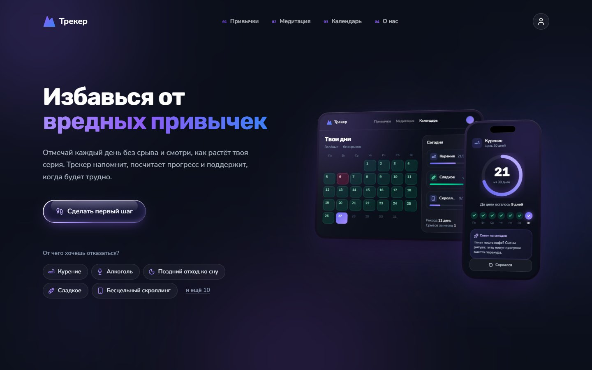
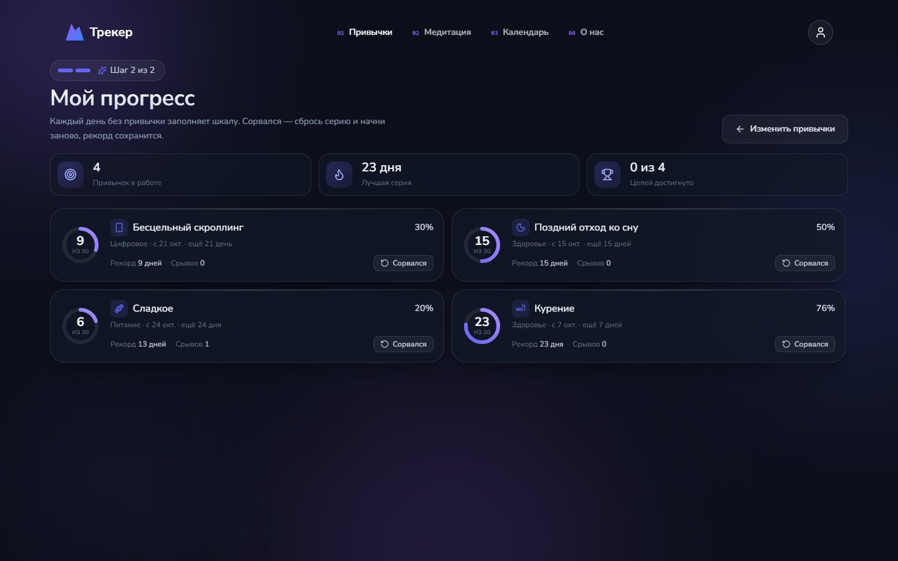
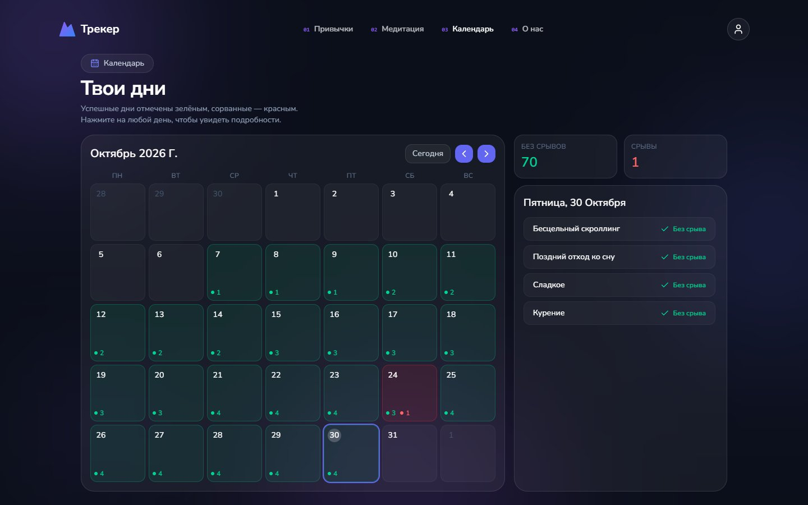
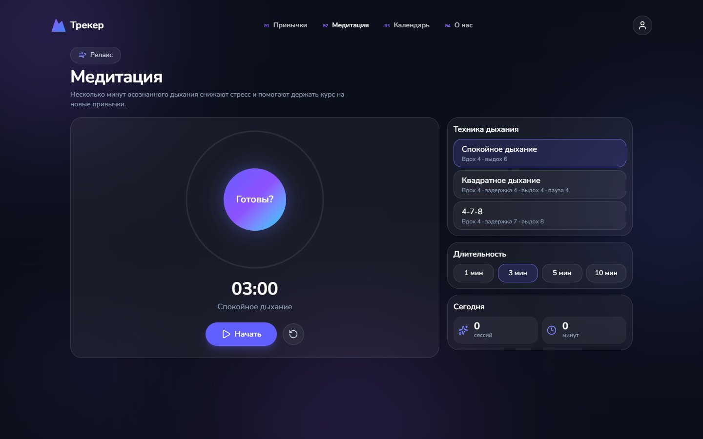
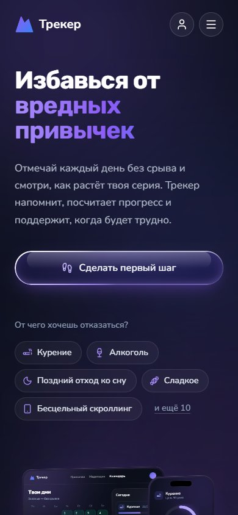
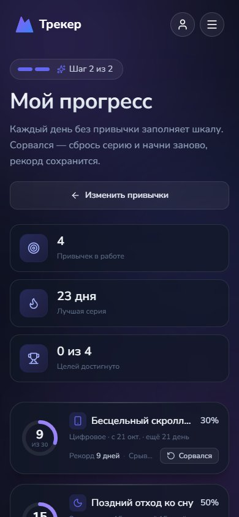
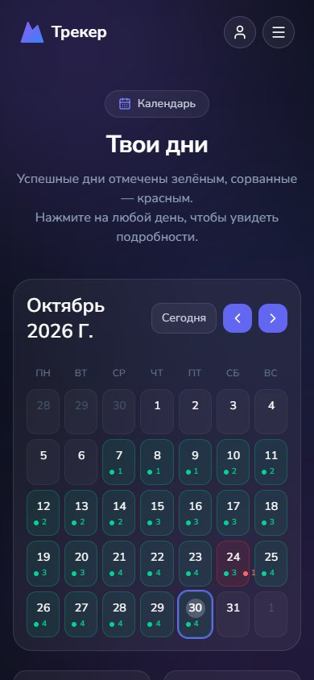

# Трекер — отказ от вредных привычек

Веб-приложение, которое помогает бросить вредную привычку: выбираешь, от чего отказываешься, ставишь цель в днях и каждый день видишь, как растёт серия без срывов.

**[Открыть демо →](https://chursinov-nikita.github.io/habit-tracker/)** · без регистрации, ставится на телефон
**[Полная версия →](https://habittracker-iota-neon.vercel.app/)** · вход через GitHub или Google, данные в облаке



## О проекте

Бросать проще, когда видно, сколько уже пройдено. Трекер считает дни без привычки, показывает прогресс к цели и сохраняет рекорд, даже если случился срыв. Медитация помогает пережить трудный момент, а календарь показывает весь путь целиком.

- **15 готовых привычек в 4 категориях** (здоровье, питание, цифровое, финансы) и свои собственные.
- **Цель в днях:** 7, 14, 30, 66 или 90. У каждой привычки своя шкала прогресса.
- **Две версии из одной кодовой базы:** полная с аккаунтом и базой данных и офлайн-версия, которая работает прямо на телефоне без интернета.

## Возможности

- Каталог привычек с поиском и фильтром по категориям, создание своей привычки.
- Прогресс: серия дней по каждой привычке, процент до цели, рекорд и число срывов.
- Кнопка «Сорвался»: серия начинается заново, лучший результат сохраняется.
- Календарь: успешные дни отмечены зелёным, дни со срывом — красным, по клику видно, что было в этот день.
- Медитация: три дыхательные техники (спокойное, квадратное, 4-7-8), таймер на 1–10 минут и статистика за день.
- Профиль со статистикой, достижениями и уровнями. Достигнутую цель отмечает праздничная анимация.
- Вход через GitHub или Google, установка на телефон как PWA.

## Скриншоты

| Мой прогресс | Календарь |
| --- | --- |
|  |  |



<p>
  
  
  
</p>

## Технологии

| Область | Что используется |
| --- | --- |
| Язык и фреймворк | TypeScript, React 19, Next.js 16 (App Router, Route Handlers) |
| Авторизация | NextAuth: OAuth через GitHub и Google, сессии в JWT |
| База данных | PostgreSQL, Prisma 7 с драйвером `@prisma/adapter-pg`, миграции |
| Стили | Tailwind CSS 4, lucide-react |
| PWA | Web App Manifest, Service Worker с офлайн-кэшем |
| Инфраструктура | Vercel (полная версия), GitHub Actions → GitHub Pages (офлайн-версия), ESLint, React Compiler |

## Технические решения

**Две версии из одного кода.** Ветка `master` — полноценное приложение с аккаунтом: данные хранятся в PostgreSQL, API построен на Route Handlers, каждый запрос проверяет сессию. Ветка `offline` — статическая сборка того же интерфейса: данные живут в `localStorage`, сервер не нужен, а GitHub Actions публикует сборку на GitHub Pages при каждом push.

**Дни считаются по часовому поясу пользователя.** Граница суток определяется не по времени сервера, а по смещению часового пояса, которое присылает клиент (с проверкой диапазона). Отметка, сделанная в 23:30, не попадёт на следующий день.

**Целостность данных.** Изменение набора привычек и сброс прогресса выполняются в одной транзакции Prisma: история, серии и рекорды не могут остаться в промежуточном состоянии.

**Срыв не обнуляет мотивацию.** При срыве серия начинается заново, а лучший результат и число срывов сохраняются. Так прогресс виден даже после неудачи.

**Офлайн и установка на телефон.** Service Worker заранее кэширует все страницы, поэтому приложение открывается без сети. При выходе новой версии обновление подхватывается автоматически.

**Интерфейс.** Отдельные раскладки для телефона и десктопа, анимированные макеты устройств на главной, звуки и вибрация при достижениях, которые можно отключить.

## Структура

```
app/
  _home/        главная страница и макеты устройств
  api/          Route Handlers: привычки, отметки, медитация, профиль
  habits/       выбор привычек и целей
  progress/     прогресс и срывы
  calendar/     календарь дней
  meditation/   дыхательные практики
  profile/      профиль и достижения
  lib/          Prisma-клиент, работа с датами
prisma/         схема и миграции БД
auth.ts         конфигурация NextAuth
```

## Запуск

Нужны Node.js 20+ и PostgreSQL.

```bash
npm install
# .env: DATABASE_URL, NEXTAUTH_SECRET, GITHUB_ID/GITHUB_SECRET, GOOGLE_ID/GOOGLE_SECRET
npx prisma migrate dev
npm run dev     # http://localhost:3000
```

Офлайн-версия собирается из ветки `offline`:

```bash
git checkout offline
npm install
npm run build   # статическая сборка в out/
```

## Автор

Никита Чурсинов — [GitHub](https://github.com/Chursinov-Nikita)
